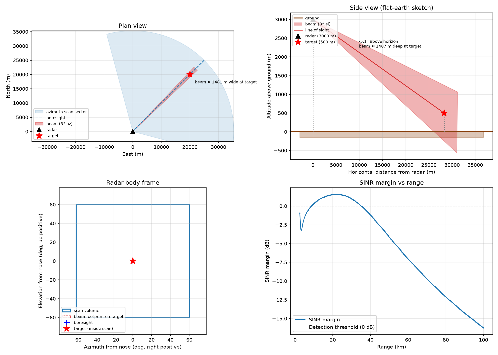

# RadarLab

RadarLab is a small radar analysis library for modelling a pulsed radar system and evaluating how it performs against a target and clutter environment. The code is organised around a data model of radar configuration and scenario geometry, then computes link budgets, detection margins, and range sweeps, with some useful diagnostics, graphs, interactive lab, and crude sensitivity analysis.

## Purpose

The package covers areas such as:

- Radar unambiguous range, range resolution, and beam geometry
- Signal-to-noise ratio does a target see at a given range
- Clutter, and how it affects detection
- Maximum detection range achievable for a given scenario
- Carrier frequency, sea state, target altitude, and cross-range displacement vs max detection range sensitivity analysis

The implementation is physics-oriented rather than simulation-heavy. It models the radar as a system (carrier, pulse, PRI, power, beam, receiver) and a scenario as a platform geometry plus target. The models are non-time-varient static models based on physical and statistical principles

## Typical use cases

- Compare candidate radar architectures before committing to a design.
- Evaluate a specific sensor against a geodetic target position.
- Measure the effect of environmental clutter, especially sea clutter.
- Sweep one parameter at a time to understand sensitivity: frequency, sea state, altitude, or horizontal displacement.
- Inspect the geometry and performance in a visual dashboard or generated plots.

## Running the project

The package exposes a small command-line entry point:

- `python -m radarlab visualise`
- `python -m radarlab diagnostics`
- `python -m radarlab lab`
- `python -m radarlab analysis target_altitude`
- `python -m radarlab analysis sea_state`
- `python -m radarlab analysis frequency`
- `python -m radarlab analysis displacement`

The `lab` entry point launches the Streamlit sandbox, where radar and scenario JSON can be edited interactively.

## Included

The model is built around a few explicit things:

- A pulsed radar system: carrier frequency, pulse width, modulation type, PRI, transmit power, beam geometry, and receiver noise figure.
- A target model: radar cross section and a Swerling fluctuation case.
- A scenario model: radar pose, target position, and a clutter type.
- A geometric conversion between geodetic coordinates and the radar's local body frame.
- Link-budget calculations: EIRP, effective aperture, echo power, noise power, and SNR/SINR at the target.
- Required detection thresholds based on detection probability and false-alarm probability.
- Clutter terms based on grazing angle and a simple sigma-0 model for ground and sea clutter.
- A static range optimisation routine that finds the maximum range satisfying a detection margin.

## Not included

The code is intentionally not a complete radar simulator. It does not include:

- time-varying target motion or target tracking
- Doppler processing, MTI, pulse-Doppler processing, or range-Doppler plots
- multi-target or multi-sensor scenarios
- radar scheduling, scan-to-scan adaptation, or tasking logic
- detailed antenna patterns beyond a simple gain and beamwidth
- realistic terrain maps, shadowing, multipath, or propagation over complex topography
- explicit atmospheric propagation effects in the main link budget beyond a small helper for path attenuation
- jammer, interference, electronic countermeasures, or stealth modelling
- a complete waveform-generation or digital signal-processing chain

## Assumptions and approximations

Several simplifying assumptions are built into the code.

- Flat Earth
- The target is static. A scenario is a single geometry; there is no motion model.
- The target is treated as a point target with a single RCS and Swerling case.
- Beam geometry is reduced to a boresight gain and azimuth/elevation beamwidth. The beam is not a full measured antenna pattern (no side/backlobes).
- Angular resolution is taken as the beamwidth, and range resolution follows the compressed pulse width approximation.
- Clutter is treated as a single homogeneous patch; the area and sigma-0 model are approximate and depend on grazing angle.
- Detection is evaluated with single-pulse SNR or SINR margin against a probability-of-detection and false-alarm threshold, rather than a full receiver architecture or integration chain.
- Atmospheric attenuation is treated with a rough sea-level approximation, not a full propagation model.
